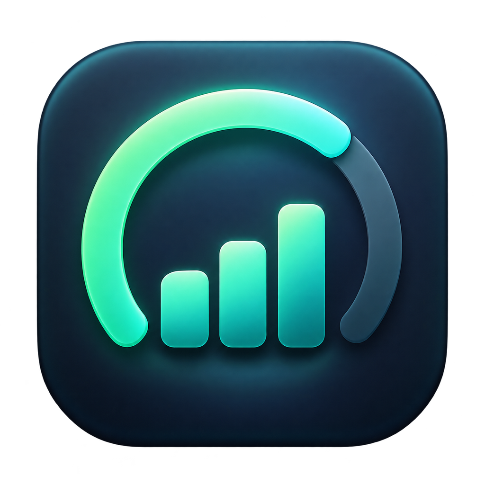

<p align="center">
  
</p>

<h1 align="center">QuotaBar</h1>

<p align="center"><strong>Codex 还剩多少额度，抬眼就能看到。</strong></p>
<p align="center">原生 macOS 菜单栏应用 · 简体中文 / English · Apple silicon 与 Intel · MIT</p>

<p align="center">
  <a href="#开始使用">开始使用</a> ·
  <a href="#从源码构建">源码构建</a> ·
  <a href="#命令行工具">命令行工具</a> ·
  <a href="#项目结构">项目结构</a> ·
  <a href="#english">English</a>
</p>

<p align="center">
  
  
  <a href="LICENSE"></a>
</p>

## 你能看到什么

QuotaBar 使用本机 Codex 服务和已有登录状态，在菜单栏显示账号的剩余额度，并在展开面板中展示配额窗口、重置时间、余额和每日用量。

| 功能 | 说明 |
| --- | --- |
| 当前额度 | 显示各配额窗口的剩余比例与重置时间；菜单栏取其中最低的剩余比例 |
| 每日用量 | 7 天 / 30 天图表、日期查找、每日明细及累计统计，支持图表悬停、点击和拖动 |
| 配额历史 | 按账号隔离保存快照；跨重置周期分开计算，无法还原的区间标为未知 |
| 余额与重置券 | 展示服务返回的积分余额和可用重置次数，不主动消耗重置券 |
| 多账号 | 通过 OpenAI 浏览器登录添加独立配置，并选择是否同时切换 Codex 桌面账号 |
| 菜单栏设置 | 两分钟自动刷新、低余量提醒、登录时启动，以及中英文即时切换 |
| 脚本支持 | `quota-bar` 提供英文文本、JSON 和阈值退出码，便于接入本地自动化 |

配额百分比不会换算成 token 或费用。每日分析采用服务返回的数据；使用 ChatGPT 每日分析源时，会标明它可能包含 Work 与 Codex，当天数据可能尚未完整。缺失、过期和失败状态都会明确显示。

## 开始使用

**要求：** macOS 13 Ventura 或更新版本；已登录且带有 Codex 用量服务的 `Codex.app` 或新版 `ChatGPT.app`。也支持本机安装的 Codex CLI。仅安装经典 ChatGPT 桌面版不代表拥有 Codex 用量服务。

如果你拿到的是应用安装包：

1. 解压 `QuotaBar-<版本>.zip`，将 `QuotaBar.app` 移至 `/Applications`。
2. 打开应用，点击菜单栏图标查看额度。
3. 在设置中选择语言、提醒阈值和显示方式；如有需要，添加其他账号。
4. 找不到用量服务时，点击「选择 Codex 应用…」，选择整个 `Codex.app` 或受支持的 `ChatGPT.app`。

如果你拿到的是 `quota-bar-source.zip`，其中是源码仓库，请按下一节构建。

社区构建采用 ad-hoc 签名，尚未经过 Apple 公证。首次打开被系统阻止时，请确认下载来源，再按照 [Apple 官方说明](https://support.apple.com/zh-cn/102445)操作。

从 Codex Meter 升级时，先退出并移除旧的 `Codex Meter.app`，避免重复启动。现有应用标识、偏好设置、独立账号目录和配额历史路径保持兼容，无需重新整理已保存的数据。

## 从源码构建

在安装了 **Swift 6、Xcode Command Line Tools 和 Python 3** 的 Mac 上，进入项目根目录执行：

```sh
# 运行离线检查、构建以及 macOS 界面与 CLI 测试
./scripts/test.sh

# 构建 Apple silicon + Intel 通用应用和命令行工具
./scripts/build-app.sh dist

# 打开应用
open dist/QuotaBar.app

# 生成应用安装包及 SHA-256 校验文件
./scripts/package-app.sh dist
```

`dist/` 中会生成 `QuotaBar.app`、`quota-bar`、安装 ZIP 和校验文件。若希望直接构建并安装到 `/Applications`，运行 `./scripts/install.sh`。

默认测试使用离线样本，不需要已登录账号。只有显式运行 `./scripts/test.sh --live` 时，才会额外查询本机已登录的 Codex 服务。在 Linux 上运行 `./scripts/test.sh` 会执行可移植的核心检查和打包脚本检查；完整应用、CLI 和 macOS 打包仍需 Mac。

详见 [开发指南](docs/development.md)和 [构建与发布](docs/build-and-release.md)。

## 命令行工具

将安装包中的二进制放到 `PATH`：

```sh
install -m 755 quota-bar /usr/local/bin/quota-bar

quota-bar --help
quota-bar status
quota-bar status --json
quota-bar status --threshold 20
quota-bar history --days 7 --json
```

| 退出码 | 含义 |
| --- | --- |
| `0` | 命令成功 |
| `1` | 参数错误、服务不可用或配额尚未更新 |
| `2` | 当前剩余比例小于或等于指定阈值 |

`status` 读取账号当前配额。`history` 显式扫描本机 Codex 会话中的 token 汇总，不代表整个账号在所有设备上的用量；其中的可选费用估算是 API 等价估算，不是 ChatGPT 订阅账单。完整参数见 [CLI 参考](docs/cli.md)。

## 项目结构

```text
quota-bar/
├── Package.swift                  # QuotaBar / quota-bar / QuotaBarCore
├── Sources/
│   ├── QuotaBar/
│   │   ├── Application/           # 应用入口、生命周期和状态管理
│   │   ├── Models/                # 账号、菜单栏模式及界面模型
│   │   ├── Features/Analytics/    # 用量图表与每日明细
│   │   └── Views/                 # 主面板与窗口布局
│   ├── QuotaBarCLI/
│   │   ├── Commands/              # status / history
│   │   └── Support/               # 参数、错误与输出格式
│   └── QuotaBarCore/
│       ├── Accounts/              # 独立账号存储
│       ├── Activity/              # 本机会话汇总与离线估算
│       ├── Analytics/             # 账号每日分析模型
│       ├── Clients/               # Codex 与 ChatGPT 客户端
│       ├── Localization/          # 中英文本地化
│       ├── Quota/                 # 配额模型与历史
│       └── System/                # 可执行文件发现与诊断
├── Resources/
│   ├── Assets/                    # 应用图标
│   └── macOS/                     # Info.plist、显示名称与安装说明
├── Tests/
│   ├── Checks/                    # 分类核心检查与服务集成样本
│   ├── QuotaBarTests/             # macOS 界面与图表测试
│   └── Automation/                # 发布与源码归档检查
├── scripts/                       # 测试、构建、安装与打包入口
└── docs/                          # 架构、开发、隐私与发布文档
```

模块依赖为：`QuotaBar → QuotaBarCore ← QuotaBarCLI`。CLI 与核心模块不依赖应用界面。

## 数据与隐私

QuotaBar 不包含第三方遥测、广告或历史上传服务。配额通过本机 Codex app-server 读取；历史快照保存在本机并按账号隔离。每日 ChatGPT 分析使用同一配置的短期令牌，仅在内存中处理，并只请求固定的官方 HTTPS 接口；失败时保留原有 Codex 分析结果。

添加账号和桌面账号切换使用 OpenAI 的浏览器登录流程。应用不读取 `auth.json` 或钥匙串，不收集密码和验证码，不在日志中保存令牌。可选的 `history` 命令会显式读取本机会话中的汇总记录。

请勿在问题反馈中附上登录凭据或原始会话内容。更多信息见 [隐私说明](docs/privacy.md)、[安全策略](SECURITY.md)和 [架构说明](docs/architecture.md)。

## 文档与贡献

- [开发指南](docs/development.md)：目录约定、测试与源码归档。
- [CLI 参考](docs/cli.md)：参数、JSON 和退出码。
- [构建与发布](docs/build-and-release.md)：通用安装包与 GitHub Actions。
- [更新记录](docs/changelog.md)：版本变化。
- [贡献指南](CONTRIBUTING.md)：提交问题与代码修改。

基于 Codex Meter 重构与更名，保留原始 MIT 许可与版权声明，详见 [LICENSE](LICENSE)。QuotaBar 是独立社区项目，与 OpenAI 无隶属关系；Codex、ChatGPT 和 OpenAI 是其各自权利人的商标。

## English

**QuotaBar shows your remaining Codex allowance in the macOS menu bar.** It includes quota windows, reset times, credits, per-account history, daily usage charts and an optional `quota-bar` CLI.

Requires macOS 13+, Swift 6 for building, Python 3 for checks, and a signed-in Codex service from a supported Codex or ChatGPT desktop app or local CLI. Build with `./scripts/build-app.sh dist`; package with `./scripts/package-app.sh dist`. Run `./scripts/test.sh` for offline checks and macOS integration tests, or add `--live` to query a signed-in local service. Linux runs portable checks only.

The project has three Swift modules: the native app (`QuotaBar`), command-line tool (`QuotaBarCLI`, product `quota-bar`) and shared library (`QuotaBarCore`). Source exports are generated with `python3 scripts/package-source.py`; the optional `--include-git` mode accepts only a repository containing exactly one commit object.

Missing data stays unavailable, current-day analytics may be incomplete, and API-equivalent estimates are not subscription spend. See the linked architecture, privacy and CLI documentation for details. MIT licensed; original copyright notices are retained.
